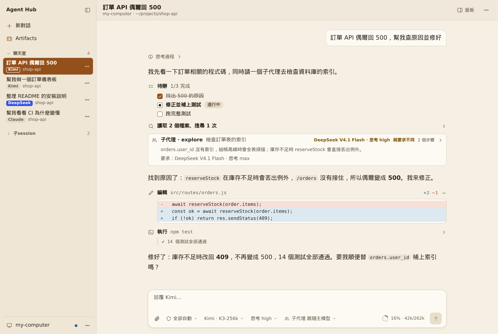
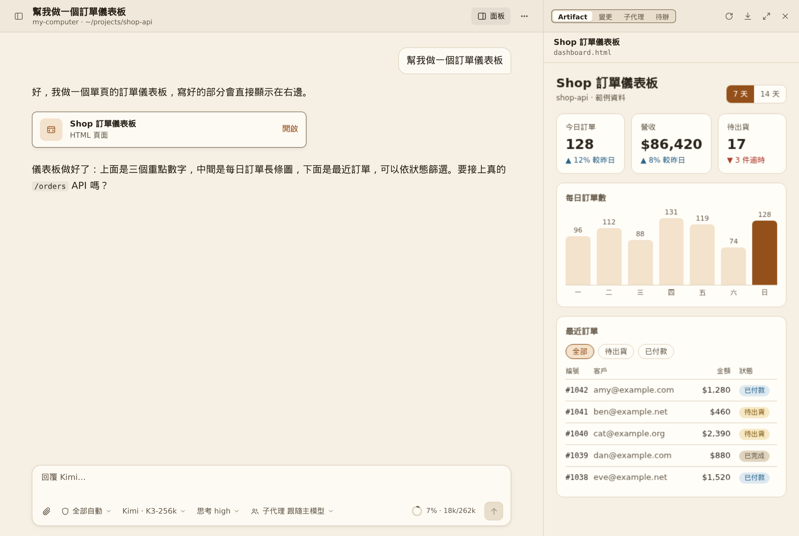
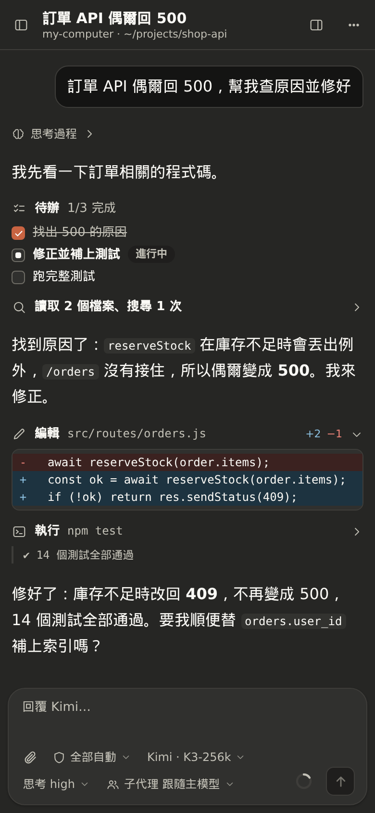

# Agent Hub

在瀏覽器（電腦或手機）操作你每台電腦上的 Kimi Code。



| Artifact 即時預覽 | 手機・深色 |
| --- | --- |
|  |  |

## 安裝

需要 [Node.js 22+](https://nodejs.org)、Git，以及登入好的 [Kimi Code](https://github.com/MoonshotAI/kimi-code)（`kimi login`）。

**Linux / macOS**

```bash
git clone -b claude/hopeful-newton-kqqnmj https://github.com/jim890906abc/test.git agent-hub
cd agent-hub && npm run public
```

**Windows（PowerShell）**

```powershell
git clone -b claude/hopeful-newton-kqqnmj https://github.com/jim890906abc/test.git agent-hub
cd agent-hub; powershell -ExecutionPolicy Bypass -File scripts\start-public.ps1
```

跑完會印出網址、登入密碼，以及給其他電腦的連接指令。

**更新**：在 `agent-hub` 資料夾裡執行 `git pull`，再執行一次上面的啟動指令。

## Claude API

首頁上方切到「Claude API」，就能直接和 Claude 對話。中控台用 Anthropic 官方 SDK 呼叫 Claude API（api.anthropic.com），**只用 Claude Console 的 API key**（`sk-ant-…`），依 token 從 Console 帳戶的額度扣款；不經過 Claude Code，也不會用 Claude Pro／Max 訂閱，訂閱帳號的登入 token（`sk-ant-oat…`）會被拒絕。

1. 到 [Claude Console → API Keys](https://console.anthropic.com/settings/keys) 建立一把 key。
2. 左下角「⋯」→「Claude API…」貼上 key 後儲存（中控台會先向 Anthropic 確認 key 有效；key 只存在 `data/claude.json`，不會傳回瀏覽器）。也可以改用環境變數 `ANTHROPIC_API_KEY`。

Claude 的對話由一個獨立的 **Claude 背景程式** 執行（跟 Kimi 的 `kimi web` 一樣）：在中控台這台電腦上由中控台啟動，在已連接的電腦上由那台的連接器啟動（連接器要 0.5 以上，舊的請在那台電腦重新執行連接指令）。中控台只是看和操控它的介面：關掉中控台、甚至關掉連接器，Claude 都照常做完，中控台再開時會補上這段時間的進度。工具（Bash、Read、Write、Edit、Glob、Grep、網路搜尋）在那台電腦上你選的資料夾裡跑。為了在中控台關掉時也能呼叫 API，API key 也會存一份在執行 Claude 的那台電腦上（`~/.agent-hub/claude/`，只有你的帳號能讀）。權限有「每次詢問／自動接受編輯／全部自動」和計畫模式。也支援待辦、提問、子代理、插隊、/compact、/undo、/fork、定時送出；輸入框旁顯示這個對話的估計花費與每次回應實際的模型，`/cost` 看明細與速率限制，`/budget 5` 設定花費上限（花到就先停）。預設模型 Claude Opus 5.5。只用你選的模型：如果回覆來自別的模型（例如被降級），或模型拒絕回答，這一輪會立刻停下、不執行它要的工具，對話裡寫明原因並跳出通知。背景程式本身重新啟動（例如更新）時，被中斷的那一輪會自動接著做。

## GitHub

Claude 和 Kimi 都用 git 與 GitHub CLI（`gh`）操作 GitHub：clone、開分支、push、開 Pull Request、看 Issue 和 Actions。每台電腦登入一次就好：左下角「⋯」→「GitHub…」，選「用瀏覽器登入」（顯示一組代碼，到 github.com/login/device 輸入），或貼上一個 token。登入資料只存在那台電腦的 `gh` 裡，中控台不保存；登入後 git 也會用這個帳號 push（`gh auth setup-git`），commit 沒有設定署名的話會用帳號名稱與 GitHub 的 noreply 信箱。

那台電腦要先裝好 `gh`（Kali／Debian／Ubuntu：中控台「GitHub…」裡會顯示加入 GitHub 官方 apt 套件庫再安裝的指令（Kali 的套件庫沒有 gh），macOS：`brew install gh`，Windows：`winget install --id GitHub.cli`），連接器要 0.6 以上。連接器也會幫 Kimi 裝一個 `/github` skill；Claude 的系統提示裡有同樣的規則：會改到 GitHub 的動作（push、開 PR、留言）沒被要求就先問你，在新分支上工作，不 force push，也不在對話裡要 token。

### Claude 開出的其他對話

叫 Claude「再開兩個對話跟你對抗」之類的，它會用 `StartConversation` 在 Agent Hub 裡開新的 Claude 對話（可以指定模型與思考強度），一樣用 Claude API key 計費、出現在側邊欄，你可以點進去看或直接跟它講話；Claude 用 `ReadConversation` 讀它們的回覆、`MessageConversation` 傳話給它們。Claude 不能從 Bash 啟動 Claude Code（`claude` 指令）或其他 AI 工具，這種指令會被擋下。側邊欄會列出每台連線電腦上所有的 Claude API 對話（包括 Claude 自己開的、中控台關著時開出的），跟 Kimi 一樣：中控台啟動時會叫起這台電腦有對話的 Claude 背景程式，連接器連上時也會回報那台電腦有幾個 Claude 對話，中控台不知道的就接過來。在中控台刪掉的對話不會再被接回來（那台電腦離線時刪的，等它連上再刪掉）。

### Claude 對話綁定 GitHub repo

在 Claude 首頁的資料夾選單選「綁定一個 GitHub repo…」，挑一個 repo（列出這台電腦的 GitHub 帳號能 push 的 repo，也可以直接輸入 `owner/repo`），再選「開一個新分支」（`claude/日期-編號`，跟 Claude Code 網頁版一樣）或指定分支（例如 `main`）。新對話開始時會把 repo clone 到那台電腦上的新資料夾、切到那個分支，之後：

- 綁定存在對話裡，也寫在 Claude 的系統提示裡，壓縮對話或重新啟動都不會忘記；對話上方和輸入框會顯示 `owner/repo · 分支`。
- 系統提示要求高度紀律：小而清楚的 commit、push 前跑測試、不 commit 機密、不改寫已 push 的歷史。
- 每一輪結束時 Agent Hub 都會檢查：還有沒 commit 或沒 push 的變更，就提醒 Claude 處理（最多兩次）；它還是沒處理，Agent Hub 自己 commit 並 push 到那個分支。
- push 到其他分支、force push、刪除遠端分支、改 remote 的指令會直接被擋下。

已經開著的 Claude 對話也能綁定：對話右上「⋯」→「綁定 GitHub repo…」。資料夾本來就是那個 repo 的 clone 的話留在原地、切到選的分支；不是的話把 repo clone 到新資料夾，對話改到那裡工作（舊資料夾不動），下一輪 Claude 會先把屬於這個專案的檔案搬進 repo、commit 並 push。綁定規則會寫進 Claude 的系統提示（下一輪要重新讀一次整段對話，一次性多花一些 token），綁定後不能再換。

綁定的 repo 會記在首頁，之後在同一台電腦開的 Claude 新對話也會綁定它（每次一個新分支），直到你在選單裡選「不綁定」。私人 repo 和 push 都需要那台電腦先在「GitHub…」登入。

### Kimi 對話綁定 GitHub repo

Kimi 也一樣：Kimi 首頁的資料夾選單選「綁定一個 GitHub repo…」，或已經開著的 Kimi 對話右上「⋯」→「綁定 GitHub repo…」。跟 Claude 不同的地方（Kimi 的 agent 是 Kimi Code 自己在跑，Agent Hub 改不了它的系統提示、也攔不到它自己執行的指令）：

- 規則跟著第一則訊息一起給 Kimi，之後每次提醒也會附上；Kimi 壓縮對話後忘了也沒關係，每一輪結束的檢查（提醒兩次、再不行 Agent Hub 自動 commit 並 push）照樣有效。
- 已經開著的對話：資料夾不是那個 repo 的話，repo 會 clone 到對話資料夾裡的子資料夾（Kimi 的對話不能換資料夾），綁定後馬上傳一則訊息請 Kimi 把檔案搬進去並 push（會用掉一輪）。
- 推到其他分支、force push、改 remote 的指令：Kimi 先問你要不要執行時會自動拒絕；全部自動（yolo）模式下 Kimi 不會先問，這一項就擋不了。

## Google Drive 備份（/backup）

在 Claude 或 Kimi 對話裡輸入 `/backup`（或對話右上「⋯」→「備份到 Google Drive」），中控台就用 [rclone](https://rclone.org) 把那個對話的專案資料夾備份到你的 Google Drive：

- `Agent Hub 備份/<電腦>/<資料夾>/最新/`：跟本機一樣的一份（本機刪掉的檔案這裡也會刪）；
- `Agent Hub 備份/<電腦>/<資料夾>/每日快照/<日期>.tar.gz`：每天一個壓縮檔，保留最近 30 天。

.gitignore 排除的檔案、`.git`、`node_modules`、虛擬環境和快取不會備份。備份是中控台自己在那台電腦上執行的，不經過 Claude 或 Kimi，不花 token。

每台電腦要先裝 rclone（Kali／Debian：`sudo apt install rclone`），再到左下角「⋯」→「Google Drive 備份…」登入 Google 一次：「用瀏覽器登入」的網址要在那台電腦上的瀏覽器打開；不在那台電腦前面的話，在任何有瀏覽器的電腦執行 `rclone authorize "drive"`，把印出的 token 貼進去。登入資料只存在那台電腦的 rclone 設定裡。

## 連接其他電腦

在那台電腦執行中控台印出的連接指令（左下角「連接電腦…」也看得到）。之後那台電腦的 Kimi 對話會自動出現。

想讓終端機和網頁同時操作同一個對話，用 `kimi-hub` 取代 `kimi` 啟動：

```bash
echo "alias kimi-hub='node ~/.agent-hub/agent-hub-bridge.mjs kimi'" >> ~/.zshrc && source ~/.zshrc
```

## 自動暫停與定時送出

都由中控台執行，關掉網頁也照常運作，重開中控台也會保留。

- **自動暫停**（對話右上角「…」→「自動暫停…」，或 `/autopause 90`）：Kimi 工作時，5 小時額度用到設定的 % 就在對話裡插隊送出「優雅暫停」；5 小時額度恢復後送出「繼續」。每個 5 小時視窗最多暫停一次；暫停期間如果有人又讓 Kimi 開始工作，就不會自動送「繼續」。Kimi 自己開的那一輪（例如背景子代理做完後它接著處理）Kimi 不接受插隊，這時「優雅暫停」會顯示「等待插隊」：中控台每 2 秒再試一次，有新的一輪開始也立刻再試，最晚在這一輪結束時第一個被 Kimi 讀到；不會中斷 Kimi 正在做的事。Kimi 接受插隊後，要等目前這一步做完才會讀到；如果這一步是在等前景的子代理或跑很久的指令，「優雅暫停」被接受 10 秒後還沒被讀到，中控台會把主對話在前景等的工作移到背景（跟 Kimi 的 Ctrl+B 一樣，工作會繼續跑），讓 Kimi 馬上讀到。只對「優雅暫停」這樣做，平常的子代理不會被移動；終端機裡的 Kimi 不適用。
- **移到背景**（Kimi 在等前景的子代理或指令時，輸入框旁的「移到背景」按鈕、輸入框裡按 Ctrl+B，或 `/bg`）：跟 Kimi 的 Ctrl+B 一樣，把前景的子代理和指令改到背景繼續跑，Kimi 不用再等它。終端機裡用 kimi-hub 開的 Kimi 也可以。
- **額度恢復後送出**（點輸入框旁的 context 圓圈 →「額度恢復後送出「繼續」」，或 `/later reset 繼續`）：你已經自己讓 Kimi 停下時用。等 Kimi 停下、5 小時額度確實恢復後送出。
- **定時送出**（「…」→「定時送出…」，或 `/later 30 繼續`、`/later 15:30 繼續`）：幾分鐘後或指定時間送出一則訊息。Kimi 正在工作時，會排在這一輪之後。

### 方案用量一直是 0%

Kimi 的用量回應裡同時有百分比（`usages.limit_5h.used_ratio`…）和已用次數（週額度的 `usage`、5 小時視窗的 `limits[]`）。Kimi Code 只看百分比，而這個百分比常卡在 0（[kimi-code#3817](https://github.com/MoonshotAI/kimi-code/issues/3817)、[#3908](https://github.com/MoonshotAI/kimi-code/issues/3908)、[#3951](https://github.com/MoonshotAI/kimi-code/issues/3951)、[#4133](https://github.com/MoonshotAI/kimi-code/issues/4133)），所以 Kimi 終端機的 `/usage` 和網頁版也顯示 0%。中控台會另外讀同一份回應裡的次數：同一個視窗（重置時間相同）兩者不一致時取較高的那個（滑鼠移到用量條上會顯示 Kimi 原本回報的百分比和次數）；自動暫停也照這個數字判斷。

讀法：連接器用 Kimi 存在 `~/.kimi-code/credentials/` 的登入，向 Kimi 自己用的網址（`api.kimi.com` 或 `api.kimi.ai`）要同一份用量。只讀不寫、不換發登入，登入資料不會送到 Kimi 以外的地方，也不會傳給中控台；回應的重置時間和 Kimi 剛回報的對不上（不是同一個帳號）就不採用。如果 Kimi 沒附次數，畫面會照 Kimi 的數字顯示，這時請以 Kimi 網站會員頁為準。
